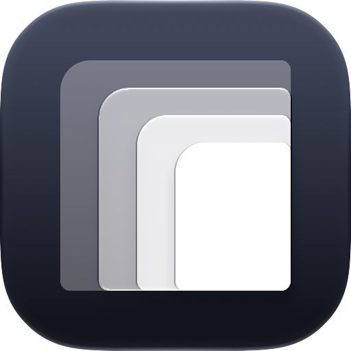

<p align="center"></p>

# sheets

A Mac terminal app where everything is a sheet: terminals, browser pages, and the groups
that hold them. Sheets slide over each other instead of replacing each other, so the way
back is always on screen.

`sheets` is a working title.

## Status

Early. The app opens a window with one terminal running your login shell. Panes can be
added, closed, renamed, and moved, but nothing is saved, so each launch starts over. Each
terminal runs a real shell. Pages are still stand-ins. The models for the pane tree, the
stack of sheets, and split layout are in place with tests.

## The idea

- Every pane can have children. A group is a pane that summarizes its children.
- The sidebar is that tree. The screen shows one path through it, each sheet over its parent.
- A sheet that gets covered is not redrawn. It stays as it was, underneath.
- A link clicked in a terminal slides a page over that terminal. Dragging it makes it a split.
- Splits are placed by dwindle: a new pane takes half of the focused one.
- Settings is a pane too, not a window. It is pinned at the bottom of the sidebar, Command-comma
  opens it, and each of its sections opens as a sheet over it.
- The title bar says the app's name in the middle. A small `…` button at its trailing end opens
  a menu of app-wide things: Check for Updates, Settings, and the version that is running.

## Using the stack

- Click a row in the sidebar to open the path to that pane, each sheet over its parent.
- Click a row in a group's sheet to open that pane over it.
- Pick another row from the same list while one is open, and its sheet stays where it is. Only
  what is on it changes. The title bar stays still and its title fades in place, and what is
  under the bar fades while moving up for a row lower in the list and down for one higher.
  Sheets that were open above it close.
- Press Escape, or Command-[, to close the top sheet. While a terminal on top runs its shell,
  Escape goes to the terminal instead.
- Click the strip of a covered sheet to go back to it, or click a row in the strip to open that
  row instead.

## Terminals

- A terminal runs your login shell, from your user record or else `/bin/zsh`, as a login
  shell, in the pane's folder, or your home folder if it has none or it is gone. The config
  file can name another shell, its arguments, and another starting folder. The shell
  sees `TERM=xterm-256color`, `COLORTERM=truecolor`, and `TERM_PROGRAM=sheets`, and `LANG`
  when it was not set.
- A terminal's shell starts the first time its sheet shows and keeps running while the pane
  exists, whether its sheet shows or not. Go to another pane and back, and it is the same
  shell with the same scrollback. Closing the pane, or a pane above it, ends the shell, and
  so does quitting.
- The terminal on top has the keyboard. Escape goes to it, since shells and `vim` need it.
  **Back** (Command-[) in the Go menu closes the top sheet whatever is in it. Command-W
  closes the pane, which ends its shell.
- A terminal's row, in the sidebar and in a group's sheet, shows the title its shell or a
  program set, or the pane's own name when none is set. Under it is the terminal's folder, with
  the home folder as `~`, such as `~/dev/acme-web · 1 page`: the folder the shell last
  reported, or else the one it started in. A long folder is cut short at its start, so its last
  folder stays readable. The sheet's title bar shows the same title as the row.
- A name typed with **Rename…** wins over the shell's title. The pane keeps its own name
  either way, and the rename field starts from it.
- A shell reports its folder only if its setup sends it (the `OSC 7` sequence), as many prompt
  frameworks do. Without that, the folder stays the one the terminal started in.
- When a shell exits by itself, its output stays, with a line at the foot saying so and
  **Start Again** (Return).
- Copy, paste, and select all are in the Edit menu, as usual. By default Option types
  characters such as é rather than acting as Meta. `terminal.option-as-meta` changes that.
- A clicked link opens in the default browser for now.

### Settings and the config file

Settings live in a plain text file, `~/.config/sheets/config` (or
`$XDG_CONFIG_HOME/sheets/config`), one `key = value` per line, each line valid TOML. The file
holds only what differs from the defaults, so it may not exist at all.
[docs/config.md](docs/config.md) lists every key with its default.

```toml
terminal.font-family = "Menlo"
terminal.font-size = 13
terminal.cursor-style = "bar"   # block, underline, or bar
terminal.option-as-meta = "left"
```

- **Settings, Terminal** shows the same settings: font, colors, cursor, keyboard and mouse,
  and shell. A change there rewrites only that key's line and keeps the rest of the file as
  it is. Each changed setting has a button that puts it back to its default.
- The app watches the file. An edit from an editor or another tool applies while the app
  runs. Look and keyboard settings reach running terminals. The shell, its arguments, the
  starting folder, and scrollback reach terminals started after the change.
- A line the app cannot use is listed in Settings, Terminal, with its line number, and its key
  keeps its last good value. An unknown key is a warning. The app always starts.
- Experiments' switches are keys too, `experiments.<name>`.
- The key table is `Sources/SheetsCore/Config/ConfigKeys.swift`. The parser, the checks,
  Settings, and `docs/config.md` all come from it. After changing a key, regenerate the doc:

```sh
SHEETS_WRITE_CONFIG_REFERENCE=1 swift test --filter ConfigReferenceTests
```

### Terminal engines

Terminals run through an engine seam in `SheetsCore`: a `TerminalEngine` makes
`TerminalSession`s, which start a shell, take a font and colors as plain values, and report
the title, the working folder, the exit status, and clicked links. A terminal pane names its
engine by id, and `TerminalSessionStore` keeps one session per pane. The first engine is
[SwiftTerm](https://github.com/migueldeicaza/SwiftTerm), in its own target,
`SheetsSwiftTermEngine`. Nothing else imports it, so another engine can sit beside it or
replace it, registered in `Sources/sheets/TerminalEngines.swift`.

## Editing panes

The app starts with one terminal, named `~` for the home folder.

- **New Terminal** (Command-T), **New Group** (Shift-Command-N), and **New Page** are in the
  File menu. The new pane opens as a sheet straight away. It goes last inside the open group,
  just after the open terminal or page, or at the end of the sidebar when nothing is open.
- A new terminal starts in the folder of the nearest group above it that has one, or else the
  home folder, and is named for that folder.
- A new group starts with its name ready to type.
- **Close** (Command-W) closes the top sheet's pane and everything under it. With only the
  sidebar showing, it closes the window. Closing a pane that has panes under it asks first.
- **Rename…** in the File menu edits the top sheet's name in its sidebar row. Return keeps the
  new name, Escape keeps the old one.
- Right-click a sidebar row, or a row in a group's sheet, for the same commands placed near
  that pane. Right-click empty space in a group's sheet to add to that group, or below the
  sidebar's rows to add at the top level.
- Settings and its sections stay as they are: they cannot be closed, renamed, or moved, and
  nothing goes under them.
- Dragging sidebar rows to move panes is an experiment, off by default. Turn it on in
  Settings, Experiments, or with `experiments.drag-to-move = true` in the config file. Drop near the top or bottom of a row to put the pane above or below
  it, or on the middle to put it inside.

## Layout

| Path | What it holds |
|---|---|
| `Sources/SheetsCore` | The logic, with no UI: the pane tree, the sheet stack, dwindle layout, the terminal engine seam and session store, the config file |
| `Sources/SheetsSwiftTermEngine` | The SwiftTerm terminal engine |
| `Sources/sheets` | The app |
| `Tests/SheetsCoreTests` | Tests for `SheetsCore`, with a fake terminal engine |
| `Tests/SheetsSwiftTermEngineTests` | Tests that run real programs in SwiftTerm, with no window |
| `Tests/SheetsAppTests` | Tests of the app's model and views, drawn in a window never put on screen |
| `docs/config.md` | Every config key with its default, made from the key table |
| `Resources/AppIcon.icon` | The app icon, an Icon Composer file drawn by `scripts/render-icon.sh` |
| `scripts/bundle.sh` | Builds and signs `build/sheets.app` |
| `scripts/render-previews.sh` | Draws the window's key states to PNG files, with no window on screen |
| `scripts/render-icon.sh` | Redraws the app icon from `AppIconDrawing.swift` |
| `scripts/release.sh` | Builds, notarizes, and publishes a release |

## Building

Needs macOS 27 and Xcode with Swift 6.4.

```sh
swift build
swift test
scripts/bundle.sh
```

`scripts/bundle.sh` builds `build/sheets.app` and does not launch it. Run the bundle, not
`swift run`, so the app gets the current system look.

```sh
open build/sheets.app
```

## Looking at it without opening it

`scripts/render-previews.sh` draws the main window offscreen, title bar included, mostly with
sample panes, and writes a PNG of each key state in light and dark to `build/renders/`. It runs the app with
`--render-previews <folder>`, which puts no window on screen, shows no Dock icon, takes no
focus, and uses a throwaway preferences suite. It never reads your config file. The renders
of Settings, Terminal that show a config file read a sample the script writes and points
`SHEETS_CONFIG_PATH` at. It starts no shell: a terminal's sheet draws a few stand-in lines
where the live terminal would be. Only a render draws them. In the app, a terminal whose
shell could not be started says so, with a Start button.

```sh
scripts/render-previews.sh
```

## The icon

The icon is drawn in Swift in `Sources/SheetsCore/AppIconDrawing.swift`, which has a few
candidate designs. `AppIconDrawing.shipped` is the one in the app. `bundle.sh` compiles it with
`actool`.

```sh
scripts/render-icon.sh                      # the shipped design into Resources/AppIcon.icon and docs/icon.png
scripts/render-icon.sh --previews <folder>  # every design and a contact sheet, repo untouched
```

## Updates and releases

The app updates itself with [Sparkle](https://sparkle-project.org). It reads `appcast.xml`
from the latest GitHub Release of this repo, and installs updates signed with the key in
`scripts/sparkle-public-key.txt`.

Only a release build has a feed. A plain `scripts/bundle.sh` build never updates itself, so a
development copy is never replaced by a release. It shows no Check for Updates item in the app
menu, and the title bar's menu shows the item dimmed.

```sh
scripts/release.sh --check          # says whether this Mac can release now, changes nothing
scripts/release.sh 1.2.0 --dry-run  # builds the zip and the feed into build/release, publishes nothing
scripts/release.sh 1.2.0            # builds, signs, notarizes, tags v1.2.0, and publishes the release
```

A release is built from `main` with a clean tree. The setup it needs is described at the top
of `scripts/release.sh`.

## License

MIT. See [LICENSE](LICENSE).

The app includes [SwiftTerm](https://github.com/migueldeicaza/SwiftTerm), and
[Sparkle](https://sparkle-project.org) for updates. SwiftTerm's license follows, and the app
carries a copy in `Contents/Resources/Licenses/SwiftTerm.txt`.

```
Copyright (c) 2019-2026 Miguel de Icaza (https://github.com/migueldeicaza)
Copyright (c) 2017-2019, The xterm.js authors (https://github.com/xtermjs/xterm.js)
Copyright (c) 2014-2016, SourceLair Private Company (https://www.sourcelair.com)
Copyright (c) 2012-2013, Christopher Jeffrey (https://github.com/chjj/)
Copyright (c) 2016 Ryan L McIntyre (Powerline Extra Symbols flame silhouette, https://github.com/ryanoasis/powerline-extra-symbols)

Permission is hereby granted, free of charge, to any person obtaining
a copy of this software and associated documentation files (the
"Software"), to deal in the Software without restriction, including
without limitation the rights to use, copy, modify, merge, publish,
distribute, sublicense, and/or sell copies of the Software, and to
permit persons to whom the Software is furnished to do so, subject to
the following conditions:

The above copyright notice and this permission notice shall be
included in all copies or substantial portions of the Software.

THE SOFTWARE IS PROVIDED "AS IS", WITHOUT WARRANTY OF ANY KIND,
EXPRESS OR IMPLIED, INCLUDING BUT NOT LIMITED TO THE WARRANTIES OF
MERCHANTABILITY, FITNESS FOR A PARTICULAR PURPOSE AND
NONINFRINGEMENT. IN NO EVENT SHALL THE AUTHORS OR COPYRIGHT HOLDERS BE
LIABLE FOR ANY CLAIM, DAMAGES OR OTHER LIABILITY, WHETHER IN AN ACTION
OF CONTRACT, TORT OR OTHERWISE, ARISING FROM, OUT OF OR IN CONNECTION
WITH THE SOFTWARE OR THE USE OR OTHER DEALINGS IN THE SOFTWARE.
```
